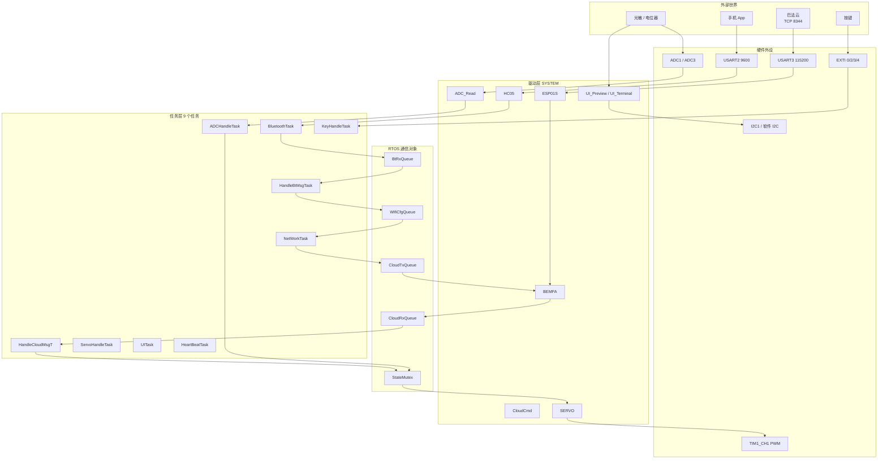

# STM32 智能安防终端

基于 **STM32F407 + FreeRTOS** 的居家安防终端。支持光敏感应自动报警、手机蓝牙配网、巴法云远程布撤防与设备控制，板载 OLED 提供表情前台与调试日志后台双界面。

> 这个工程的重点不在功能数量，而在于**多路异步串口数据在 RTOS 下如何互不干扰**：中断只搬运字节，协议解析与业务状态机全部在任务上下文推进。

---

## 功能

| 模块 | 说明 |
|---|---|
| 本地报警 | ADC1 采集光敏电阻，ADC3 采集电位器作为现场可调阈值；布防状态下光照低于阈值触发 LED + 蜂鸣器，舵机锁定到报警角度 |
| 蓝牙配网 | 手机通过 HC-05 发送 `WIFI:ssid,password`，解析后交由 ESP-01S 连接路由器，成功后写入 AT24C02，掉电不丢 |
| 云端控制 | ESP-01S 连接巴法云 TCP 服务，支持 `ARM` / `DISARM` / `LED:ON` / `LED:OFF` / `BEEP:ON` / `BEEP:OFF` / `QUERY` |
| 舵机巡检 | 布防时 10° ~ 170° 往返扫描（周期 4 秒），报警时转 90° 锁定 |
| 人机界面 | SSD1306 OLED 128x64，前台显示 64x64 表情与 5 组状态图标，后台显示实时日志 |
| 按键 | 4 个按键走 EXTI 中断，中断内仅消抖置位，业务由任务处理 |

---

## 系统架构



### 任务划分

| 任务 | 栈 | 周期 | 职责 |
|---|---|---|---|
| `NetWorkTask` | 2048 B | 5 ms | 网络中枢：推进 ESP01S / BEMFA 状态机、消费发送队列 |
| `BluetoothTask` | 512 B | 5 ms | 从环形缓冲取出整行蓝牙数据 |
| `HeartBeatTask` | 512 B | 30 s | 置心跳事件标志，由网络任务发送 |
| `HandleBtMsgTask` | 512 B | 队列阻塞 | 解析表情命令与配网信息 |
| `HandleCloudMsgT` | 512 B | 队列阻塞 | 解析云端指令并驱动外设 |
| `KeyHandleTask` | 512 B | 事件阻塞 | 按键业务：布撤防、消音、界面切换 |
| `ADCHandleTask` | 1024 B | 500 ms | 采样两路 ADC，判定报警条件 |
| `ServoHandleTask` | 512 B | 5 ms | 推进舵机扫描状态机 |
| `UITask` | 512 B | 5 ms | 独占刷新 OLED，增量重绘 |

### 通信对象

- 邮箱类：`CloudRxQueue`(4×128) `CloudTxQueue`(2×128) `BtRxQueue`(2×128) `BtTxQueue`(4×64) `WifiCfgQueue`(1×64)
- 互斥量：`StateMutex` 保护布防/报警/光照等共享状态，`DebugMutex` 串行化串口与 OLED 输出
- 事件标志：`KeyEventFlags`（中断置位）、`NetEventFlags`（心跳触发）

### 两条设计约定

1. **中断只做搬运。** `HAL_UART_RxCpltCallback` 只把字节写入环形缓冲区，`HAL_GPIO_EXTI_Callback` 只置事件位。所有 AT 指令解析、`+IPD` 载荷拼装、JSON 式键值解析都在任务里完成，中断最长执行时间为微秒级。
2. **`+IPD` 按长度读，不按行切。** 云端下发的消息体本身可能包含 `\r\n`，按行切分会截断载荷，因此按 `+IPD,<len>:` 声明的长度读满。

---

## 引脚分配

| 功能 | 引脚 | 外设 |
|---|---|---|
| 光敏电阻 | PA5 | ADC1_IN5 |
| 阈值电位器 | PF7 | ADC3_IN5 |
| 舵机 PWM | PE9 | TIM1_CH1 |
| 调试串口 | PA9 / PA10 | USART1 115200 |
| HC-05 蓝牙 | PA2 / PA3 | USART2 9600 |
| ESP-01S | PB10 / PB11 | USART3 115200 |
| AT24C02 | PB8 / PB9 | I2C1 |
| OLED SSD1306 | PC6 / PC7 | 软件 I2C |
| LED0 ~ LED3 | PF9 / PF10 / PE13 / PE14 | GPIO |
| 蜂鸣器 | PF8 | GPIO |
| KEY0 ~ KEY3 | PA0 / PE2 / PE3 / PE4 | EXTI0/2/3/4 |

---

## 目录结构

```
├── Core/            CubeMX 生成的启动与 HAL 初始化
├── Drivers/         STM32F4xx HAL + CMSIS
├── Middlewares/     FreeRTOS 内核与 CMSIS-RTOS v2 封装
├── SYSTEM/          自研驱动与应用模块（15 个）
│   ├── HC05 / ESP01S / BEMFA     串口与云协议
│   ├── CloudCmd / BtConfig       指令解析
│   ├── ADC_Read / SERVO / LED / BEEP / KEY
│   └── Oled / UI_Preview / UI_Terminal / at24c02 / WifiStorage
├── Fonts/           OLED 字库与位图
├── MDK-ARM/         Keil 工程文件
└── FreeRTOS_STM32.ioc
```

---

## 编译

1. 安装 **Keil MDK-ARM 5**，并通过 Pack Installer 安装 `Keil.STM32F4xx_DFP`
2. 打开 `MDK-ARM/FreeRTOS_STM32.uvprojx`
3. 编译并下载到 STM32F407ZET6 开发板

> 编译产物（`.o` / `.axf` / `.map` 等）已通过 `.gitignore` 排除，克隆后需自行重新编译。

## 使用前配置

打开 `SYSTEM/BEMFA.h`，把以下两项换成你自己的巴法云账号信息：

```c
#define BEMFA_UID    "your-bemfa-private-uid"
#define BEMFA_TOPIC  "your-topic-name"
```

> ⚠️ 巴法云 UID 属于账号凭据，**不要把自己的真实 UID 提交到公开仓库**。

---

## 已知限制 / 后续计划

- [ ] 9 个任务目前全部为 `osPriorityNormal`。舵机 5 ms 节拍在 OLED 刷新期间可能被推迟，后续计划将 `ServoHandleTask` 提升优先级
- [ ] `DebugMutex` 粒度偏大：`UITask` 持锁刷新软件 I2C 期间会阻塞其他任务的日志输出，计划拆分为串口锁与显示锁
- [ ] Wi-Fi 凭据以明文存于 AT24C02，后续可加简单校验或加密
- [ ] 心跳与上报间隔目前为编译期常量，后续考虑支持云端下发配置

---

## License

未指定。如需开源请补充 LICENSE 文件。
